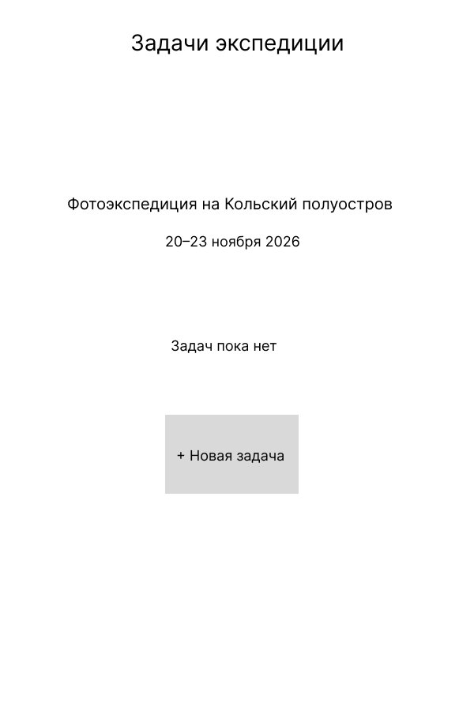
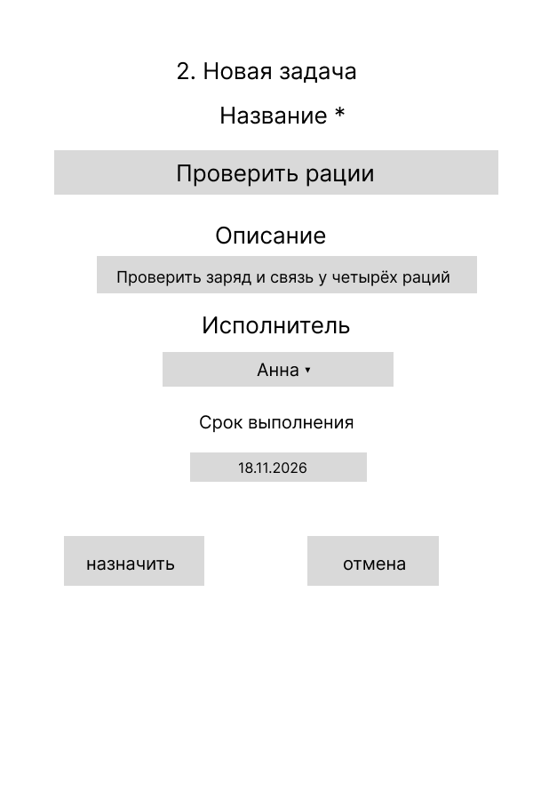
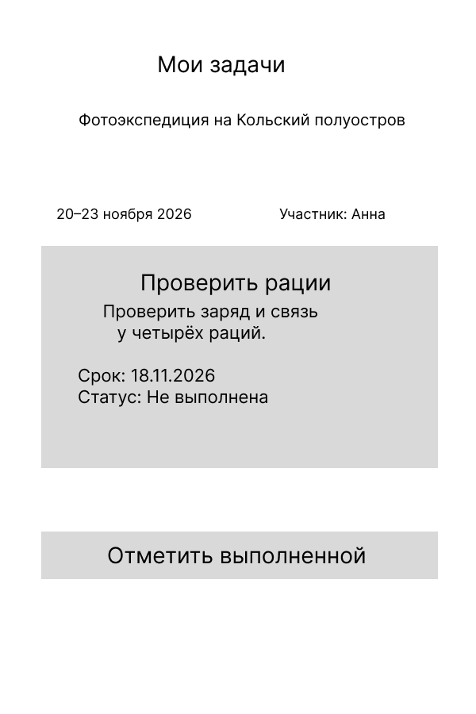
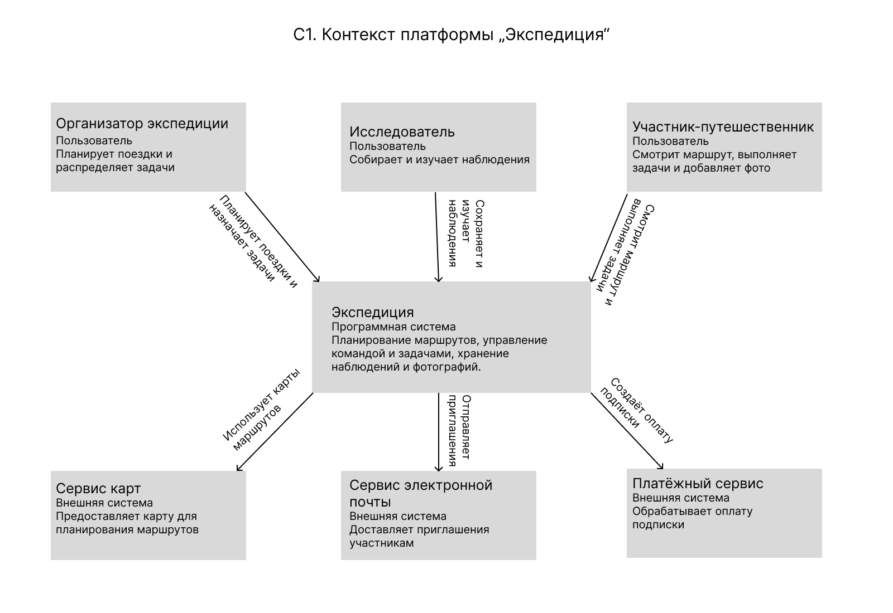
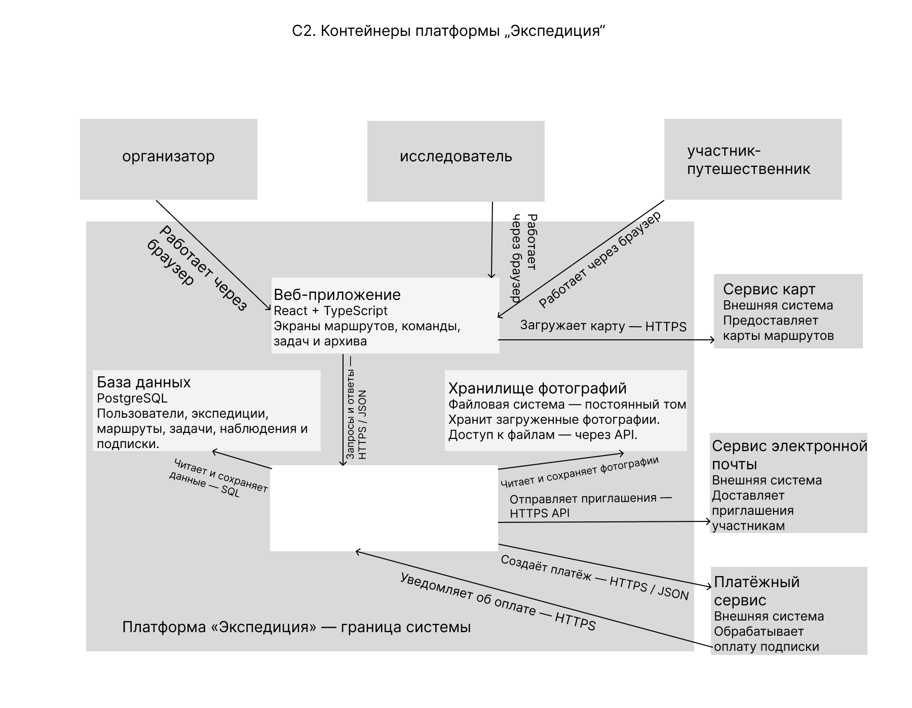

# Задание №1: Проект «Экспедиция»

Платформа для организации экспедиций на Севере.

**Бизнес-модель:** B2B + B2B2C. Организаторы экспедиций и исследовательские команды оплачивают подписку, аренду и обслуживание наблюдательных станций (B2B). Туроператоры размещают коммерческие экспедиции, а туристы бронируют места через платформу, которая получает комиссию (B2B2C).

## Elevator Pitch

Гиды, туроператоры и исследовательские команды тратят много времени на подготовку северных экспедиций: проверяют маршруты и погодные условия в разных приложениях, координируют участников через мессенджеры, а результаты наблюдений хранят в разрозненных таблицах и журналах. Мы предлагаем «Экспедицию» — единую платформу для планирования маршрутов, управления участниками, задачами и оборудованием, бронирования мест и хранения результатов поездок. Особенность проекта — использование данных наблюдательных станций непосредственно на маршрутах и накопление общего архива наблюдений. Организаторы смогут упростить подготовку и координацию выездов, исследовательские команды — систематизировать собранные данные, а туристы и фотографы — находить подходящие экспедиции. Планируем зарабатывать на подписке для организаторов и команд, аренде и обслуживании станций, а также комиссии за бронирование коммерческих поездок.

## Lean Canvas


# Задание №2. Гипотезы проекта «Экспедиция»

Проект «Экспедиция» — платформа для планирования и сопровождения северных экспедиций.

Эксперименты пока не проведены. Указанные цены, конверсии и расходы являются расчётными предположениями.

## 1. Две ключевые гипотезы

### Гипотеза №1 — готовность платить

Организаторы регулярных северных экспедиций готовы платить **3 000 рублей в месяц** за единый инструмент для планирования поездок, координации участников и хранения наблюдений.

Предполагаем, что **не менее 5 из 20 организаторов**, которым покажут решение и предложат месячный пилот, оплатят участие.

Это главная гипотеза: если организаторы удовлетворены существующими таблицами и мессенджерами и не готовы платить за улучшение процесса, подписная модель окажется под вопросом.

### Гипотеза №2 — повторное использование

Организаторы будут возвращаться к платформе при подготовке следующих экспедиций. Предполагаем, что одна команда оплатит в среднем **8 месяцев использования за всё время сотрудничества**.

Это именно оплаченные месяцы: между ними возможны сезонные перерывы.

Проверять гипотезу будем по повторным оплатам и продолжительности использования. Первым сигналом станет продление после пилота; для проверки среднего срока потребуются наблюдения за клиентами в течение нескольких сезонов.

## 2. Проверка главной гипотезы без разработки — HADI

**Критичный риск из Lean Canvas:** риск ценности — готовы ли организаторы платить за платформу?

- **H — Hypothesis / Гипотеза.** Не менее 5 из 20 целевых организаторов оплатят месячный пилот по цене 3 000 рублей.
- **A — Action / Действие.** Найдём организаторов через сайты туроператоров, профессиональные сообщества и партнёрские контакты. Покажем макет платформы в Figma с описанием функций и ценой. Предложим месячный пилот: общий план поездки, список участников, задачи и архив материалов организуем с помощью готовых таблиц и облачного хранилища. Заранее объясним, как работает пилот. Наблюдательные станции являются отдельной услугой.
- **D — Data / Данные.** Зафиксируем количество обращений, проведённых демонстраций и реальных оплат, причины отказов, расходы на привлечение. Главная метрика — доля оплативших среди участников демонстраций.
- **I — Insights / Выводы.** Если оплатят минимум 5 из 20 организаторов, конверсия составит **25%** — это предварительный сигнал готовности платить в выбранном сегменте. Если оплат будет меньше, исходная гипотеза не получит поддержки: изучим причины отказов и пересмотрим предложение, цену или сегмент клиентов.

## 3. Привлечение клиентов и расчёт CAC

**CAC** — стоимость привлечения одного платящего клиента.

Первые клиенты будут приходить через:

- Прямые предложения гидам и небольшим туроператорам.
- Партнёрства с турклубами и базами отдыха.
- Публикации и рекламу в сообществах организаторов северных поездок.

**Предполагаемые расходы на одну кампанию:**

- Работа по поиску клиентов, обращениям и демонстрациям — **20 000 рублей**.
- Реклама и размещения в профильных сообществах — **10 000 рублей**.
- Всего — **30 000 рублей**.

**Предполагаемая воронка:**

1. Обратимся к 100 подходящим организаторам.
2. 20% согласятся на демонстрацию — 20 организаторов.
3. 25% участников демонстраций оплатят пилот — 5 клиентов.

**CAC = 30 000 / 5 = 6 000 рублей.**

Таким образом, в расчётном сценарии привлечение одной платящей команды обходится в 6 000 рублей.

## 4. Монетизация и расчёт LTV

В проекте предусмотрены три источника выручки:

- Подписка для организаторов экспедиций и исследовательских команд.
- Аренда и обслуживание наблюдательных станций.
- Комиссия за бронирование коммерческих экспедиций туристами.

Базовый расчёт ниже относится к **B2B-подписке**. Для аренды оборудования и бронирований потребуются отдельные расчёты затрат и доходов.

**LTV** в этом расчёте — доход от одного клиента за всё время использования после вычета переменных расходов.

**Предположения:**

- Подписка — **3 000 рублей в месяц**.
- Переменные расходы на одну команду: серверные ресурсы, хранение данных, обслуживание и платёжные комиссии — **600 рублей в месяц**.
- Маржинальный доход за месяц: **3 000 − 600 = 2 400 рублей**.
- Средний срок платного использования — **8 месяцев суммарно**, с учётом сезонности.

**LTV = 2 400 × 8 = 19 200 рублей.**

**LTV / CAC = 19 200 / 6 000 = 3,2.**

Затраты на привлечение окупаются за:

**6 000 / 2 400 = 2,5 оплаченного месяца**, то есть в течение третьего оплаченного месяца.

При выбранных предположениях LTV превышает CAC более чем втрое. Это предварительный признак сходимости экономики подписки. Из оставшейся маржи необходимо покрывать постоянные расходы, включая разработку и зарплаты команды. Фактический результат будет зависеть от стоимости привлечения и продлений подписки.

600 рублей в месяц — предварительная оценка переменных расходов работающей платформы. Затраты на ручной пилот, включая время исполнителя, будем учитывать отдельно.

Если клиент оплатит только 3 месяца вместо предполагаемых 8, LTV составит 2 400 × 3 = 7 200 рублей, а LTV / CAC — 1,2. После привлечения останется 1 200 рублей на покрытие постоянных расходов. Поэтому повторные оплаты — ключевой фактор: расчёт с показателем 3,2 станет обоснованнее после проверки удержания клиентов.

## 5. Резервный план — Pivot

Если организаторам окажется полезен сервис, но ежемесячная подписка будет неудобна из-за сезонности, проверим **оплату за отдельную экспедицию**.

Организатор будет покупать доступ к планировщику и рабочему пространству команды на период подготовки и проведения конкретного выезда.

Это **Revenue Pivot — изменение способа монетизации**. Основная аудитория сохраняется, а оплата привязывается к отдельной поездке. После проверки цены и частоты покупок пересчитаем CAC и LTV.

## 6. Lean Canvas резервного сценария: оплата за экспедицию


# Задание №3. User Stories проекта «Экспедиция»

## Роли пользователей

1. **Организатор экспедиции** — гид, туроператор или руководитель исследовательской группы. Планирует маршрут и координирует команду.
2. **Исследователь** — участник научной или учебной группы. Собирает наблюдения и работает с результатами экспедиции.
3. **Участник-путешественник** — турист или фотограф. Изучает план поездки, выполняет свои задачи и делится материалами.

Исследователь и путешественник входят в команду экспедиции и могут пользоваться общими возможностями участника.

## Список User Stories

### Организатор экспедиции

1. Я хочу создать экспедицию с названием и датами, чтобы собрать материалы поездки в одном месте.
2. Я хочу отметить точки маршрута на карте, чтобы команда знала план перемещения.
3. Я хочу пригласить участников, чтобы собрать команду экспедиции.
4. Я хочу назначить участникам задачи и сроки, чтобы распределить обязанности.
5. Я хочу видеть задачи команды и их статусы, чтобы вовремя замечать задержки.
6. Я хочу видеть прогноз погоды для точек маршрута, чтобы учитывать условия при планировании.
7. Я хочу создавать новую экспедицию по шаблону предыдущей, чтобы не составлять повторный маршрут и задачи с нуля.
8. Я хочу автоматически получать отчёт с маршрутом, наблюдениями и фотографиями, чтобы быстрее подготовить итоги поездки.

### Исследователь

9. Я хочу сохранять наблюдения с местом и временем, чтобы не терять собранные данные.
10. Я хочу искать записи в общем архиве по дате и автору, чтобы находить материалы для анализа.
11. Я хочу выгружать наблюдения в CSV, чтобы обрабатывать их в привычных программах.
12. Я хочу видеть показания наблюдательных станций на маршруте, чтобы сопоставлять их со своими наблюдениями.

### Участник-путешественник

13. Я хочу принять приглашение в экспедицию, чтобы получить доступ к материалам команды.
14. Я хочу видеть даты и маршрут поездки, чтобы понимать её план.
15. Я хочу видеть свои задачи и отмечать их выполненными, чтобы организатор знал о моей готовности.
16. Я хочу добавлять фотографии с местом и временем съёмки, чтобы делиться результатами с командой.
17. Я хочу заранее сохранить маршрут и задачи на телефон, чтобы просматривать их без интернета.
18. Я хочу забронировать место в коммерческой экспедиции, чтобы присоединиться к подходящей поездке.

## Приоритизация MoSCoW

Приоритеты заданы для первой и следующей версий продукта. Номера соответствуют историям выше.

### Must have — обязательно для MVP

- **1–5:** создание экспедиции, маршрут, приглашение команды, назначение задач и контроль их выполнения.
- **9–10:** сохранение наблюдений и поиск в общем архиве.
- **13–16:** подключение участника, просмотр плана и задач, отметка об их выполнении и добавление фотографий.

### Should have — добавить в MLP

- **6:** прогноз погоды на маршруте.
- **11:** выгрузка наблюдений в CSV.
- **17:** просмотр заранее сохранённых маршрута и задач без интернета.

### Could have — дополнительные возможности MLP

- **7:** создание экспедиции по шаблону предыдущей.
- **8:** автоматическое формирование отчёта.

### Won’t have this time — позже

- **12:** подключение наблюдательных станций.
- **18:** бронирование коммерческих экспедиций туристами.

## MVP и MLP

**MVP — основа продукта:** истории **1–5, 9–10 и 13–16**. Организатор создаёт поездку, составляет маршрут, приглашает команду и распределяет задачи. Участники видят план, выполняют поручения и сохраняют наблюдения и фотографии в общем архиве. Этого достаточно, чтобы проверить, полезно ли командам единое пространство для подготовки экспедиций.

**MLP — дополнительные удобства:** к MVP добавляются истории **6–8, 11 и 17**. Команда получает прогноз погоды на маршруте и офлайн-просмотр плана. Исследователь может выгрузить данные, а организатор — повторить прежний маршрут и быстро сформировать отчёт. Особенно ценной может оказаться подготовка новой поездки по шаблону и автоматический отчёт; это предположение нужно проверить на пользователях.

## Требования к двум главным историям MVP

### История 1. Создание экспедиции

**Как организатор, я хочу создать экспедицию с названием и датами, чтобы собрать материалы поездки в одном месте.**

**Функциональные требования:**

1. Организатор может указать название, описание, дату начала и дату окончания экспедиции.
2. Название и обе даты обязательны. Название после удаления пробелов по краям содержит от 3 до 100 символов; описание — не более 2 000 символов.
3. Дата окончания не может быть раньше даты начала. При ошибке система указывает проблемное поле, сохраняет остальные введённые данные и не создаёт экспедицию.
4. После успешного создания система сохраняет экспедицию с уникальным номером, назначает текущего пользователя организатором и показывает поездку в его списке.
5. Создать экспедицию может только авторизованный организатор с активным доступом. Повторная отправка одного запроса не создаёт вторую экспедицию.

**Нефункциональные требования:**

1. Не менее 95% запросов создания получают ответ сервера за **2 секунды или быстрее** при 50 активных пользователях и общей нагрузке 5 запросов в секунду в течение 10 минут.
2. Успешно созданная экспедиция и все её поля сохраняются после перезапуска приложения.
3. Форма доступна без горизонтальной прокрутки при ширине экрана **360 пикселей**; её можно заполнить с клавиатуры.
4. Данные формы передаются между браузером и сервером по **HTTPS**.

### История 4. Назначение задачи участнику

**Как организатор, я хочу назначить участнику задачу со сроком выполнения, чтобы распределить обязанности.**

**Функциональные требования:**

1. Организатор может указать название задачи, описание, исполнителя и дату выполнения.
2. Название, исполнитель и дата обязательны. Название после удаления пробелов по краям содержит от 3 до 120 символов; описание — не более 2 000 символов.
3. Исполнителем можно выбрать одного человека, уже вошедшего в команду этой экспедиции. Срок может быть раньше начала поездки, если задача относится к подготовке.
4. Сохранённая задача получает уникальный номер и статус «Не выполнена». Она появляется в общем списке экспедиции и в списке исполнителя с одинаковым сроком и статусом.
5. Назначать задачи может только организатор этой экспедиции. При выборе человека из другой команды, ошибке в полях или повторной отправке одного запроса некорректная либо дублирующая задача не создаётся.

**Нефункциональные требования:**

1. Не менее 95% запросов создания задачи получают ответ сервера за **2 секунды или быстрее** при 50 активных пользователях и общей нагрузке 5 запросов в секунду в течение 10 минут.
2. Название, срок, статус и исполнитель успешно сохранённой задачи остаются неизменными после перезапуска приложения.
3. Посторонний пользователь не может прочитать задачу даже по прямой ссылке: сервер проверяет доступ при каждом запросе.
4. Форма доступна без горизонтальной прокрутки при ширине экрана **360 пикселей**. Ошибки объясняются текстом, а не только цветом.

# Задание №4. DDD, BDD и прототипы экранов проекта «Экспедиция»

Возьмём один путь из MVP: перед выездом организатор поручает участнику проверить рации. Участник выполняет поручение, а организатор видит результат в общем списке. Этот путь связывает истории №4, №15 и №5 из ДЗ №3.

## 1. Доменные зоны (DDD)

Приложение делится на пять зон. У каждой зоны есть своя ответственность и словарь. Например, зона «Команда» знает, кто уже принял приглашение, а зона «Задачи» использует эти сведения при выборе исполнителя.

| Зона | За что отвечает | Глоссарий |
|---|---|---|
| **Экспедиции и маршруты** | Организатор создаёт поездку, задаёт даты и порядок прохождения точек. | **Экспедиция** — одна поездка команды с названием и датами. **Маршрут** — упорядоченный список точек поездки. **Точка маршрута** — место с названием и координатами. |
| **Команда и приглашения** | Хранит состав каждой экспедиции и права людей в ней. | **Организатор** — человек, управляющий конкретной экспедицией. **Приглашение** — предложение присоединиться к её команде. **Участник** — человек, уже входящий в состав команды. Одного отправленного приглашения для этого недостаточно. |
| **Задачи** | Организатор распределяет поручения, участники видят свои сроки и отмечают результат. | **Задача** — одно поручение в рамках экспедиции. **Исполнитель** — участник команды, которому оно назначено. **Срок** — дата, к которой нужно выполнить поручение. **Статус** — «Не выполнена» или «Выполнена». |
| **Наблюдения и архив** | Команда сохраняет и находит результаты поездки по месту, дате и автору. | **Наблюдение** — запись о том, что участник заметил в определённом месте и в определённое время. **Вложение** — фотография, прикреплённая к записи. **Архив** — совокупность наблюдений и материалов одной экспедиции. |
| **Подписка и доступ** | Определяет, на какой период команда получила доступ к планировщику в основной подписной модели. | **Подписка** — право команды пользоваться платформой в оплаченный период. **Платящая команда** — клиент, оплачивающий подписку. **Активный доступ** — состояние, при котором текущая дата входит в оплаченный период. |

**Как зоны взаимодействуют в нашем примере:** у команды есть активный доступ. Экспедиция задаёт контекст поездки; состав команды определяет, кого можно назначить. Сама задача хранится один раз. «Задачи команды» и «Мои задачи» показывают одну и ту же запись с разных сторон. Архив нужен для полевых материалов; отметка о выполнении поручения остаётся в задачах.

## 2. Критический путь MVP (BDD)

**Сценарий: проверка раций перед фотоэкспедицией.** Организатору важно узнать, готово ли оборудование, не переспрашивая каждого участника в чате.

- **Дано:** Лена — организатор фотоэкспедиции на Кольский полуостров с 20 по 23 ноября 2026 года. У команды активна подписка. Анна приняла приглашение. В экспедиции пока нет задач.
- **Когда:** Лена создаёт задачу «Проверить рации», выбирает Анну, ставит срок 18 ноября и нажимает «Назначить».
- **Тогда:** в списке Лены и в разделе «Мои задачи» Анны появляется одна и та же задача со сроком 18 ноября и статусом «Не выполнена». Срок раньше выезда допустим: рации нужно проверить во время подготовки.
- **Когда:** Анна проверяет рации и нажимает «Отметить выполненной».
- **Тогда:** у Анны статус меняется на «Выполнена». Лена обновляет общий список и видит ту же задачу с этим статусом.

## 3. Wireframes — ключевые экраны

### Экран 1. Задачи экспедиции

Организатор видит название поездки, даты и пустой список задач. Кнопка «Новая задача» открывает форму назначения.



### Экран 2. Создание задачи

Организатор указывает название, описание, исполнителя и срок. Название, исполнитель и срок обязательны. В списке исполнителей — только участники этой экспедиции. Кнопка «Назначить» сохраняет задачу, «Отмена» возвращает к списку без сохранения.



### Экран 3. Мои задачи

Анна видит назначенное поручение, описание, срок и статус «Не выполнена». После проверки раций нажимает «Отметить выполненной». Статус меняется на «Выполнена». Организатор увидит обновлённый статус после обновления общего списка задач.



## 4. JSON-контракты

В сценарии два действия изменяют данные: Лена назначает задачу, Анна отмечает выполнение. Ниже — проект запросов и ответов для этих действий. Сервер определяет текущего пользователя по авторизованной сессии. Идентификаторы в примерах условные.

### Ручка 1. Назначить задачу

`POST /api/v1/expeditions/{expedition_id}/tasks`

Пример: Лена отправляет запрос для экспедиции `exp_42`. Тип тела — `application/json`. Для повторной отправки той же формы клиент передаёт тот же заголовок `Idempotency-Key: assign-radio-001`. Для новой задачи формируется новый ключ.

**Запрос:**

```json
{
  "title": "Проверить рации",
  "description": "Проверить заряд и связь у четырёх раций.",
  "assignee_id": "user_17",
  "due_date": "2026-11-18"
}
```

**Ответ при создании — 201 Created:**

```json
{
  "id": "task_105",
  "expedition_id": "exp_42",
  "title": "Проверить рации",
  "description": "Проверить заряд и связь у четырёх раций.",
  "assignee_id": "user_17",
  "due_date": "2026-11-18",
  "status": "open"
}
```

**Правила:**

- Назначать задачи может организатор этой экспедиции. Поля `title`, `assignee_id` и `due_date` обязательны. Название — от 3 до 120 символов после удаления пробелов по краям, описание — до 2 000 символов. Дата — существующая календарная дата в формате `YYYY-MM-DD`.
- Сервер проверяет, что исполнитель входит в команду на момент сохранения. Статус `open` («Не выполнена») устанавливается автоматически.
- Если клиент повторит тот же запрос с тем же ключом от имени того же организатора в той же экспедиции, сервер вернёт ответ с прежним номером задачи. Дубликат не появится. Если при том же ключе изменилось содержимое запроса, сервер вернёт `409 Conflict`.

**Пример ошибки — 422 Unprocessable Content:** выбран человек, который ещё не принял приглашение. Форма показывает ошибку у поля «Исполнитель»; задача не создаётся.

```json
{
  "error": {
    "code": "ASSIGNEE_NOT_IN_TEAM",
    "field": "assignee_id",
    "message": "Выберите участника этой экспедиции."
  }
}
```

### Ручка 2. Отметить задачу выполненной

`PATCH /api/v1/expeditions/{expedition_id}/tasks/{task_id}`

Пример: Анна отправляет запрос для `exp_42` и `task_105`. Тип тела — `application/json`. Эта операция меняет только статус.

**Запрос:**

```json
{
  "status": "done"
}
```

**Ответ при успехе — 200 OK:**

```json
{
  "id": "task_105",
  "expedition_id": "exp_42",
  "title": "Проверить рации",
  "description": "Проверить заряд и связь у четырёх раций.",
  "assignee_id": "user_17",
  "due_date": "2026-11-18",
  "status": "done"
}
```

**Правила:**

- В этом сценарии отметить выполнение может назначенный исполнитель, пока он входит в команду. Сервер проверяет принадлежность задачи указанной экспедиции и права текущего пользователя.
- Значение `done` отображается как «Выполнена». Если Анна повторно отправит тот же запрос, сервер вернёт `200 OK` с текущим состоянием. Общее число задач и число выполненных останутся равны одному.
- Если задача не принадлежит указанной экспедиции или недоступна пользователю, сервер возвращает `404 Not Found` без данных задачи. Для обеих ручек запрос без авторизации возвращает `401 Unauthorized`.

**Пример ошибки — 403 Forbidden:** другой участник этой же команды пытается отметить поручение Анны. Статус не меняется.

```json
{
  "error": {
    "code": "NOT_ASSIGNEE",
    "message": "Отметить выполнение может только исполнитель задачи."
  }
}
```

# Задание №5. Схема C4 и выбор технологий для MVP

## 1. Схема C4

### C1. Контекст

Платформа «Экспедиция» помогает организаторам планировать поездки,
распределять задачи и хранить результаты экспедиций.

Основные пользователи:
- Организатор экспедиции — планирует поездку и управляет командой.
- Исследователь — сохраняет и изучает наблюдения.
- Участник-путешественник — просматривает маршрут, выполняет задачи
  и добавляет фотографии.

Внешние системы:
- Сервис карт — предоставляет карты для планирования маршрутов.
- Сервис электронной почты — доставляет приглашения участникам.
- Платёжный сервис — обрабатывает оплату подписки.



### C2. Контейнеры

Внутри платформы выделены четыре контейнера:

- Веб-приложение — интерфейс, с которым пользователи работают
  через браузер.
- Сервер API — обрабатывает запросы, проверяет права пользователей
  и выполняет правила работы с экспедициями, командой и задачами.
- База данных — хранит пользователей, экспедиции, маршруты,
  задачи, наблюдения и сведения о подписках.
- Хранилище фотографий — хранит загруженные файлы.

Веб-приложение обращается к API по HTTPS, используя JSON
для передачи структурированных данных. Сервер работает
с PostgreSQL и файловым хранилищем.

Карту веб-приложение загружает из внешнего сервиса.
Сервер API отправляет приглашения через почтовый сервис
и создаёт платежи через платёжный сервис.
После уведомления об оплате сервер обновляет статус подписки.

Доменные зоны из ДЗ №4 реализуются как модули одного серверного
приложения.



## 2. Выбор технологий для MVP

### Фронтенд: React + TypeScript

React позволяет собирать интерфейс из повторно используемых
компонентов: карточек задач, форм, списков участников.
TypeScript помогает проверять типы данных при разработке,
например поля задачи и допустимые значения её статуса.
Для MVP создаём веб-приложение с адаптацией под телефон.

### Бэкенд: Python + Django + Django REST Framework

Django предоставляет средства работы с пользователями,
базой данных и административным интерфейсом.
Django REST Framework используем для реализации JSON API
из ДЗ №4, проверки входных данных и прав доступа.
Например, назначать задачу может организатор экспедиции,
а отмечать её выполнение — назначенный исполнитель.

### База данных: PostgreSQL

Данные проекта связаны между собой: участники входят
в экспедиции, задачи относятся к поездкам и исполнителям.
PostgreSQL позволяет хранить эти связи, проверять их
с помощью внешних ключей и выполнять изменения в транзакциях.
В базе также сохраняются сведения о фотографиях
и их принадлежности конкретной экспедиции.

### Хранилище фотографий: файловая система, постоянный том

Для MVP фотографии сохраняются в отдельном постоянном томе
сервера. Файлы сохраняются при обновлении приложения.
Такой вариант прост для первоначального развёртывания.

Доступ к фотографиям выполняется через API после проверки
прав пользователя на материалы соответствующей экспедиции.


